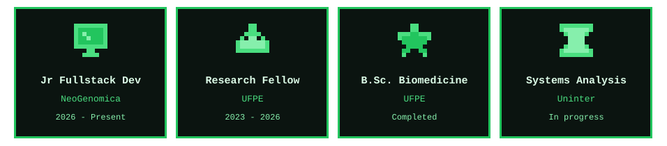
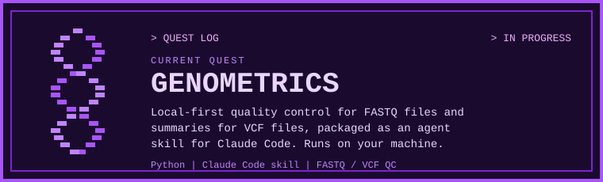

<!-- Hero -->

 

   

 

> AI Engineer and Jr. Fullstack Developer with a background in Biomedical Sciences and Bioinformatics. I build production-ready LLM applications, agentic workflows, and scalable backend and data systems.

I focus on **prompt and context engineering, RAG, tool calling, Model Context Protocol (MCP) integrations, and agent orchestration**, with backend APIs in **Python, Java, and Ruby**. My bioinformatics background shapes how I design data pipelines for genomics, healthcare, and analytics.

 

 

  

 

  

     

 

  

 

